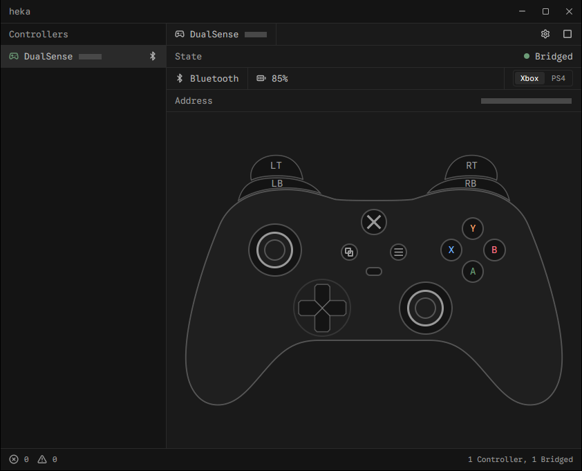
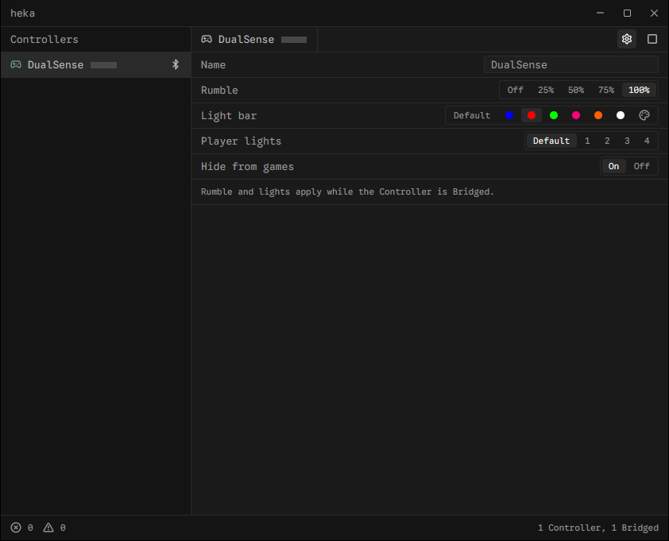

# heka

[](https://github.com/kouzoukian/heka/actions/workflows/ci.yml)

**Use your DualSense or DualShock 4 as an Xbox or PS4 controller in Windows games.**
A tray app written in Rust.

[Download](https://github.com/kouzoukian/heka/releases/latest) ·
[Setup](#setup) ·
[Troubleshooting](#troubleshooting) ·
[Building from source](#building-from-source)

<p align="center">
  
</p>

heka reads your PlayStation controller (the **Controller**), creates a **Virtual
Controller** that games see in its place, and Hides the real one so that games do not see
it twice. The live pairing of the two is a **Bridge**.

## Features

- **Xbox 360 or DualShock 4 output**, chosen and remembered for each Controller.
- **Rumble** with both, plus **lightbar colour, touchpad and motion** with PS4 output.
- **USB and Bluetooth.** A Controller on both is listed once and read over USB.
- **Brief disconnections:** the Virtual Controller stays for 30 seconds while the
  Controller reconnects.
- **No double input:** the real Controller is hidden from games through HidHide.
- **Up to 4 Controllers**, each with its own name, rumble strength and lights.
- **A log** you can read in the window and attach to a report. It stays on your PC.
- **Portable:** a zip with no installer. No telemetry.

## Setup

You need Windows 10 or 11 (x64) and these drivers:

| Driver | Needed? | What it does |
| ------ | ------- | ------------ |
| [ViGEmBus](https://github.com/nefarius/ViGEmBus/releases/latest) | **Required** | Creates the Virtual Controllers. Without it heka only lists Controllers and shows their input. Its author retired it in 2023, so it gets no further updates. |
| [HidHide](https://github.com/nefarius/HidHide/releases/latest) | Recommended | Hides Controllers from games. Without it, games may see each Controller twice. |

1. Install both drivers with their official installers, and restart Windows if asked.
   heka never downloads or runs an installer itself.
2. Download `heka-v<version>-windows-x64.zip` from
   [Releases](https://github.com/kouzoukian/heka/releases/latest) and extract it to a
   folder you will keep.
3. Close other controller tools (see [Conflicts](#conflicts-with-other-tools)).
4. Run `heka.exe`. It is not code signed, so Windows SmartScreen may warn the first time:
   choose **More info**, then **Run anyway**.
5. Connect your Controller. It is Bridged automatically, as an Xbox controller until you
   choose otherwise.

If a driver is missing, heka says which one and links to its installer. Press
**Check again** after installing it. heka itself needs no Visual C++ Redistributable or
Rust toolchain.

To connect over Bluetooth, pair the Controller in Windows' Bluetooth settings. To start
pairing, hold **PS** and **Create** (DualSense) or **PS** and **Share** (DualShock 4)
until the light bar flashes.

## Supported Controllers

| Controller                       | USB | Bluetooth | Status                                |
| -------------------------------- | --- | --------- | ------------------------------------- |
| DualSense                        | yes | yes       | Supported                             |
| DualSense Edge                   | yes | yes       | Supported, not tried on a real Edge   |
| DualShock 4 (both revisions)     | yes | yes       | **Experimental**                      |

**DualShock 4 support is experimental.** It was written from public descriptions of the
Controller and has never been tried on a real one. Please
[report](https://github.com/kouzoukian/heka/issues) what works and what does not.

The DualSense Edge's extra Fn and back buttons are not read by heka. The DualShock 3,
Sony's wireless USB adaptor and controllers from other makers are not supported.

## Using heka

The window lists the Controllers on the left. Select one to see its state, Active Link,
battery level and a live drawing of its input, and to choose:

- Its **Output Type**, what its Virtual Controller is: **Xbox** (Xbox 360) or **PS4**
  (DualShock 4). Changing it replaces the Virtual Controller, so a running game may need
  to be restarted.
- **Stop** and **Start**, the button at the top right. A Stopped Controller is not
  Bridged, and games see it as it is. heka still shows its input and battery.
- Its [settings](#controller-settings), behind the button beside it.

heka remembers all of these for each Controller. Up to 4 can be Bridged at once; a fifth
is listed, with its input and battery, but not Bridged.

|                                             | Xbox | PS4 |
| ------------------------------------------- | ---- | --- |
| Buttons, sticks and triggers                | yes  | yes |
| Rumble                                      | yes  | yes |
| Lightbar colour chosen by the game          | no   | yes |
| Touchpad, gyroscope and accelerometer       | no   | yes |

With the Xbox Output Type, Create (Share on a DualShock 4) is View, Options is Menu and
PS is Guide. The touchpad click does nothing. The mute button does nothing with either
Output Type. There is no remapping.

A Controller connected over both USB and Bluetooth is listed once, and heka reads it over
USB. A Controller that loses both is **Held** for 30 seconds: its Virtual Controller
stays, with everything released, and carries on when the Controller returns.

### Controller settings

<p align="center">
  
</p>

- **Name**, shown in place of the Controller's model, up to 24 characters.
- **Rumble**, how strongly the Controller rumbles when a game asks: off, 25%, 50%,
  75% or 100%.
- **Light bar**, a colour of your own: one of six, any other from the picker (typed as
  a hex value or set with the hue, saturation and lightness sliders), or **Rainbow**,
  which goes round all the colours every 6 seconds. A colour set by a game wins, so with
  the PS4 Output Type yours shows while the game sets none. **Default** leaves the light
  bar alone.
- **Player lights** (DualSense only), the pattern of player 1 to 4 on the white lights
  under the touchpad. **Default** leaves them alone.
- **Hide from games**, on unless you turn it off. See
  [Hiding Controllers](#hiding-controllers).

Rumble and lights apply while the Controller is Bridged.

### Log view

The button at the right of the status bar opens the log; press it again, or select a
Controller, to go back. It lists what heka did in this run, newest first. **Copy log**
puts it on the clipboard and **Open log folder** shows the log files. See
[The log](#the-log).

### Tray

Closing the window leaves heka running in the notification area, with every Bridge. Click
the tray icon to open the window again. Right-click it for **Start with Windows** (off by
default; heka then starts in the tray) and **Quit**. Quitting removes the Virtual
Controllers and restores the Hidden Controllers.

## Hiding Controllers

While a Controller is Bridged or Held, heka Hides it with HidHide: it adds the Controller
to HidHide's hidden devices, adds itself to the allowed applications and turns hiding on.
When the Bridge ends, or heka quits, it undoes what it changed. Entries that you or
another tool added stay as they were.

With **Hide from games** off for a Controller, heka does not Hide it: games see it
beside its Virtual Controller, which can cause double input. Turn it off only for a
game or app that needs the Controller itself.

- **A game or app that opened the Controller before it was Hidden keeps seeing it.** Start
  heka before the game. If you see double input, restart the game, or unplug the
  Controller and plug it back in within 30 seconds.
- **Close the HidHide Configuration Client.** While it (or HidHideCLI) is open, heka
  cannot change HidHide and shows that HidHide is busy. heka keeps trying, both to Hide
  and to restore.
- **Applications on HidHide's allowed list still see Hidden Controllers.**
- Leave HidHide's inverse application cloak off. With it on, a Controller is hidden only
  from the applications in the list, and heka warns you.
- While hiding is on, everything else in HidHide's hidden devices is hidden too.
- Do not add the same Controller to HidHide by hand while heka is Bridging it: heka cannot
  tell that entry from its own and removes it afterwards.
- **If heka is killed or the PC loses power, Controllers can stay Hidden.** Start heka
  again: it restores them.

## Conflicts with other tools

Run one controller tool at a time. Other tools read the same Controller, send it their
own rumble and light bar colours, and may create their own virtual controllers.

- **DS4Windows**: does the same job as heka. Quit it, from its tray icon too, before
  starting heka. If it is on HidHide's allowed list, it still sees Controllers that heka
  Hides.
- **DualSenseX**: quit it before starting heka. Otherwise the two compete for rumble and
  the light bar, and games may see an extra controller.
- **Steam Input**: Steam can read a PlayStation controller itself and give games its own
  virtual controller, which causes double input. Turn off Steam Input for PlayStation
  controllers in Steam's controller settings. If Steam was already running when heka Hid
  the Controller, restart Steam.
- **A game does not respond, or reads the wrong buttons**: some games need Steam Input on
  and others need it off. Try both in the game's own controller setting in Steam, and
  close and reopen the game after each change. With it on, pick a gamepad layout: a layout
  that sends keyboard, mouse or game actions replaces the buttons of the Virtual
  Controller.

## Troubleshooting

- **A connected Controller is not listed.** If heka says it was found but cannot be
  opened, quit other controller tools, which may hold it exclusively. In the HidHide
  Configuration Client, check whether the Controller is already hidden: if so, untick it,
  or add `heka.exe` to the allowed applications. Close the client again.
- **The game sees two controllers.** See [Hiding Controllers](#hiding-controllers).
- **The game sees none.** Check that the Controller's state says **Bridged**, and try the
  other Output Type.
- **Reporting a problem.** [Open an issue](https://github.com/kouzoukian/heka/issues) and
  attach [the log](#the-log), after reading what it holds.

## Files, updating and removing

heka sends no telemetry and does not update itself. It keeps its settings in
`%APPDATA%\heka`, and its log and its record of HidHide changes in `%LOCALAPPDATA%\heka`.

To update, quit heka and replace its files with those of the new release. If you move
the folder, run heka once so that Start with Windows points to its new place.

To remove it, turn off **Start with Windows**, choose **Quit**, then delete heka's folder
and the two folders above. If heka was killed, run it once and quit before deleting
anything, so that it restores your Controllers.

### The log

`%LOCALAPPDATA%\heka\heka.log` is the current run and `heka.previous.log` the one before
it, each at most 1 MiB. They hold, with the time of each: heka's start and version, the
drivers found, Controllers connecting and disconnecting, Bridges, what heka changed in
HidHide, errors and crashes.

The log names your Controllers by their **Bluetooth addresses**, and it holds device paths
and the folder heka runs from, which may include your Windows user name. heka sends it
nowhere. Remove what you would rather not share before attaching it to a report.

## Building from source

You need Rust through [rustup](https://rustup.rs) (the version is set in
`rust-toolchain.toml`), the Visual Studio C++ build tools and a Windows SDK. Release
builds compile shaders with the SDK's `fxc.exe`; set `GPUI_FXC_PATH` if it is not found.

```
cargo run -p heka-app           # a debug build, with a console for messages
cargo run -p heka-package       # the release zip, in target/dist
cargo test --workspace
cargo run -p heka-lint          # fails on a code comment
```

The code carries no comments ([why](docs/adr/0003-no-code-comments.md)): decisions go in
[docs/adr](docs/adr), owed work in an issue.

`cargo run -p heka-app --example ui_preview` opens the window over made-up data, without
a Controller or the drivers.

`heka-package` builds `heka.exe` without running it, checks that it needs only DLLs that
come with Windows, collects the third-party notices and writes the zip.

To publish a release, set the version in `Cargo.toml` (`[workspace.package]`), commit it
together with the updated `Cargo.lock`, wait for CI to pass on `main`, then push a tag
with the same version, such as `v0.2.0`. GitHub Actions builds the zip and publishes the
GitHub Release.

### Project layout

| Crate          | What is in it                                                                 |
| -------------- | ----------------------------------------------------------------------------- |
| `heka-core`    | Report parsing, translation, Bridge lifecycle and settings, with no Windows calls |
| `heka-windows` | HID, ViGEmBus, HidHide and autostart access                                   |
| `heka-app`     | The window ([GPUI](https://www.gpui.rs)) and the tray                         |
| `heka-package` | The release zip and its third-party notices                                   |
| `heka-lint`    | The check that bans code comments                                             |

Windows and the drivers sit behind traits that `heka-core` defines, so its tests run with
fakes in their place. [CONTEXT.md](CONTEXT.md) defines the terms used in the code, and
[docs/adr](docs/adr) records the main decisions.

## License

heka is licensed under either of the [MIT license](LICENSE-MIT) or the
[Apache License, Version 2.0](LICENSE-APACHE), at your option.

The theme is Min Dark (Solid), from Miguel Solorio's Min Theme and its Zed port by
Phillip Bronzel, under the MIT license. The font is
[Google Sans Code](https://github.com/googlefonts/googlesans-code), under the SIL Open
Font License. The release zip carries their notices (`LICENSE-MIN-THEME` and
`LICENSE-GOOGLE-SANS-CODE`) and those of everything built into `heka.exe`
(`THIRD-PARTY-NOTICES.txt` and `THIRD-PARTY-NOTICES-RUST.html`).

heka is not affiliated with or endorsed by Sony Interactive Entertainment or Microsoft.
PlayStation, DualSense, DualShock and Xbox are trademarks of their owners.
