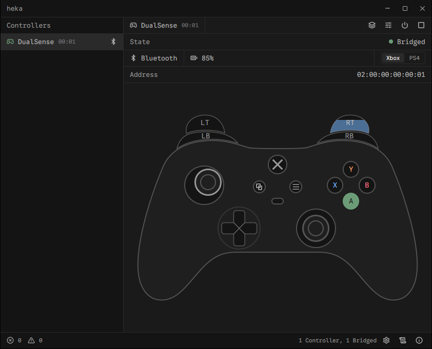

# heka

[](https://github.com/kouzoukian/heka/actions/workflows/ci.yml)

**Use your DualSense or DualShock 4 as an Xbox or PS4 controller in Windows games.**
A tray app written in Rust.

[Website](https://heka.kouzoukian.dev) ·
[Documentation](https://heka.kouzoukian.dev/docs/) ·
[Download](https://github.com/kouzoukian/heka/releases/latest)

<p align="center">
  
</p>

heka reads your PlayStation controller (the **Controller**), creates a **Virtual
Controller** that games see in its place, and Hides the real one so that games do not see
it twice. The live pairing of the two is a **Bridge**. The
[documentation](https://heka.kouzoukian.dev/docs/) covers Profiles, settings,
[supported Controllers](https://heka.kouzoukian.dev/docs/controllers/) (DualShock 4 is
experimental) and [troubleshooting](https://heka.kouzoukian.dev/docs/troubleshooting/).

## Setup

You need Windows 10 or 11 (x64) and these drivers:

| Driver | Needed? | What it does |
| ------ | ------- | ------------ |
| [ViGEmBus](https://github.com/nefarius/ViGEmBus/releases/latest) | **Required** | Creates the Virtual Controllers. Without it heka only lists Controllers and shows their input. Its author retired it in 2023, so it gets no further updates. |
| [HidHide](https://github.com/nefarius/HidHide/releases/latest) | Recommended | Hides Controllers from games. Without it, games may see each Controller twice. |

1. Install both drivers with their official installers, and restart Windows if asked.
   heka never downloads or runs an installer itself.
2. Download `heka-v<version>-windows-x64.zip` from
   [Releases](https://github.com/kouzoukian/heka/releases/latest) and extract it to a
   folder you will keep.
3. Close other controller tools (see [Conflicts](https://heka.kouzoukian.dev/docs/conflicts/)).
4. Run `heka.exe`. It is not code signed, so Windows SmartScreen may warn the first time:
   choose **More info**, then **Run anyway**.
5. Connect your Controller. It is Bridged automatically, as an Xbox controller until you
   choose otherwise.

If a driver is missing, heka says which one and links to its installer. Press
**Check again** after installing it. heka itself needs no Visual C++ Redistributable or
Rust toolchain.

To connect over Bluetooth, pair the Controller in Windows' Bluetooth settings. To start
pairing, hold **PS** and **Create** (DualSense) or **PS** and **Share** (DualShock 4)
until the light bar flashes.

heka sends no telemetry and does not update itself. Its one request over the internet asks
GitHub for the latest release, and you can turn it off. See
[updating and removing](https://heka.kouzoukian.dev/docs/files/) it.

## Building from source

You need Rust through [rustup](https://rustup.rs) (the version is set in
`rust-toolchain.toml`), the Visual Studio C++ build tools and a Windows SDK. Release
builds compile shaders with the SDK's `fxc.exe`; set `GPUI_FXC_PATH` if it is not found.

```
cargo run -p heka-app           # a debug build, with a console for messages
cargo run -p heka-package       # the release zip, in target/dist
cargo test --workspace
cargo run -p heka-lint          # fails on a code comment
```

The code carries no comments ([why](docs/adr/0003-no-code-comments.md)): decisions go in
[docs/adr](docs/adr), owed work in an issue.

`cargo run -p heka-app --example ui_preview` opens the window over made-up data, without
a Controller or the drivers.

`heka-package` builds `heka.exe` without running it, checks that it needs only DLLs that
come with Windows, collects the third-party notices and writes the zip.

To publish a release, set the version in `Cargo.toml` (`[workspace.package]`), commit it
together with the updated `Cargo.lock`, wait for CI to pass on `main`, then push a tag
with the same version, such as `v0.2.0`. GitHub Actions builds the zip and publishes the
GitHub Release.

### Website

The website and its documentation are in `site`, and need Node 24 and
[pnpm](https://pnpm.io). User documentation is in `site/content/docs`.

```
pnpm --dir site install
pnpm --dir site dev        # the site at http://localhost:3000
pnpm --dir site check      # no code comments, tests and types
pnpm --dir site build      # the static site, in site/out
```

### Project layout

| Crate          | What is in it                                                                 |
| -------------- | ----------------------------------------------------------------------------- |
| `heka-core`    | Report parsing, translation, Bridge lifecycle and settings, with no Windows calls |
| `heka-windows` | HID, ViGEmBus, HidHide, autostart and web access                              |
| `heka-app`     | The window ([GPUI](https://www.gpui.rs)) and the tray                         |
| `heka-package` | The release zip and its third-party notices                                   |
| `heka-lint`    | The check that bans code comments                                             |

`site`, outside the Rust workspace, is the website.

Windows and the drivers sit behind traits that `heka-core` defines, so its tests run with
fakes in their place. [CONTEXT.md](CONTEXT.md) defines the terms used in the code, and
[docs/adr](docs/adr) records the main decisions.

## License

heka is licensed under either of the [MIT license](LICENSE-MIT) or the
[Apache License, Version 2.0](LICENSE-APACHE), at your option.

The themes are Min Dark (Solid) and Min Light (Solid), from Miguel Solorio's Min Theme
and its Zed port by Phillip Bronzel, under the MIT license. The font is
[Google Sans Code](https://github.com/googlefonts/googlesans-code), under the SIL Open
Font License. The release zip carries their notices (`LICENSE-MIN-THEME` and
`LICENSE-GOOGLE-SANS-CODE`) and those of everything built into `heka.exe`
(`THIRD-PARTY-NOTICES.txt` and `THIRD-PARTY-NOTICES-RUST.html`).

heka is not affiliated with or endorsed by Sony Interactive Entertainment or Microsoft.
PlayStation, DualSense, DualShock and Xbox are trademarks of their owners.
